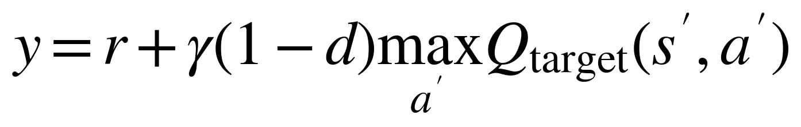
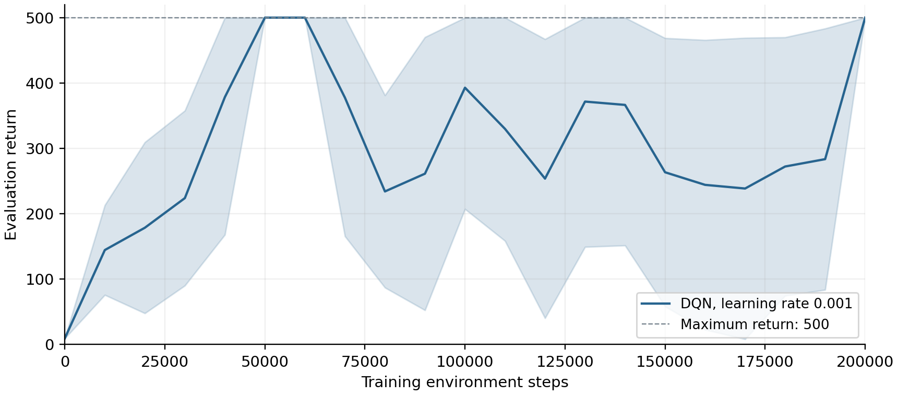
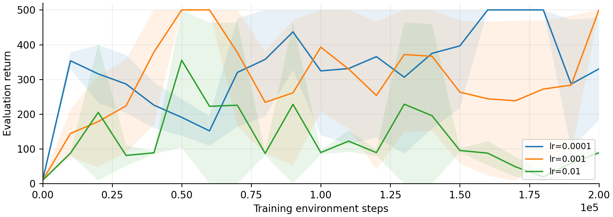
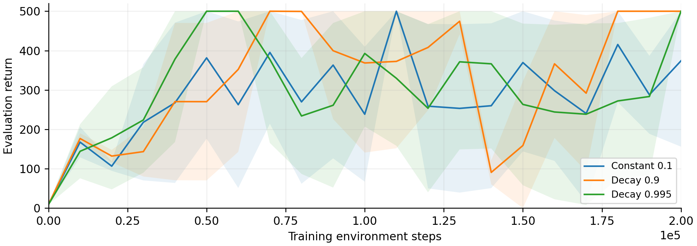
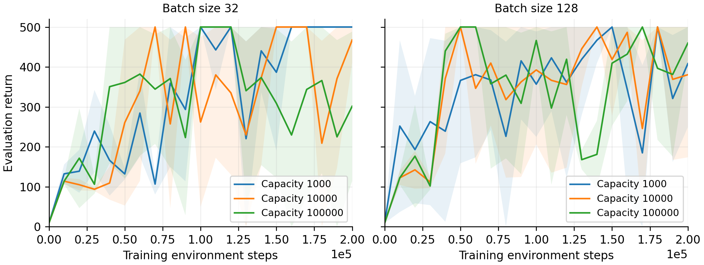

# Workshop 3：深度 Q 学习最终报告

作者：Zhengnan Cao、Yuchen Yang

本报告合并 Task 1 与 Task 2 全部三道题，统一采用已审核的实验结果。每个设置使用三个训练种子（0、1、2），训练 200,000 步；每 10,000 个训练步进行一次贪心评估，每次 10 回合，评估初始种子为 10000-10009。横轴不包含评估步数。曲线为三个训练种子的均值，阴影为一倍样本标准差，不平滑。

表格回报为均值 ± 标准差；最后三次评估先在每个种子内平均。“达标”指连续三次评估均值不低于 475，步数为成功种子的确认步数中位数，并列出成功种子数；不表示此后永久稳定。 参考：课程 ELEN90098 Workshop 3 讲义。三个种子的结果仅作本实验描述，不代表普遍排名。

## Task 1 - Question 1：CartPole 环境

### Question / 题目

CartPole 的状态空间、动作空间和奖励结构是什么？它们是有限还是无限、离散还是连续？环境是确定性的还是随机的？

### Answer / 解答

| 项目 | 解答 |
|---|---|
| 状态 | 小车位置、小车速度、杆角度和杆角速度，共四个实数变量。状态空间连续、无限。 |
| 动作 | 0 表示向左推，1 表示向右推。动作空间离散、有限，共两个动作。 |
| 奖励 | 每步 +1，包括首次失败的终止步。即时奖励离散、有限；CartPole-v1 最多 500 步，因此每回合最大回报为 500。 |
| 确定性 | 给定状态和动作后，物理转移是确定的；重置时的初始状态带随机扰动，因此不同回合的回报仍可能不同。 |

小车位置超出约 ±2.4 米或杆角度超出约 ±12 度时终止；达到 500 步时间上限属于截断。

## Task 1 - Question 2：DQN 训练

### Question / 题目

在 CartPole-v1 上训练 DQN，使其达到最高回报 500。使用 TensorBoard，提交评估回报随环境步数变化的曲线，并简要说明训练是否成功。

### Submit / 提交结果

下图为所需评估曲线，采用本次修正版实验中学习率 0.001 的三个种子结果，不再使用旧 Task 1 实验。

参数：三层、每层 64 个隐藏单元，学习率 0.001，折扣系数 0.99，Replay 容量 100,000，batch size 64，每 500 次梯度更新同步目标网络。先采集 1,000 步再学习；epsilon 从 1 开始，每回合乘 0.995，最低为 0.02。

DQN 的目标值为：

其中 d 在环境真正终止时为 1，否则为 0；时间上限截断仍允许自举。

### Discussion / 讨论与解答

**学习曲线是否说明训练成功？**

三个种子最终的 10 回合评估均值都达到 500，满足最高回报要求。但最后三次评估的平均值为 351.9 ± 82.1，说明训练后期仍出现过下降，不能称为全程稳定收敛。

这些保存的评估结果另有 TensorBoard 标量导出，放在独立验收材料中；提交曲线使用相同的评估记录。

## Task 2 - Question 1：学习率

### Question / 题目

比较至少三种学习率，研究学习率对训练的影响。本实验使用 0.0001、0.001、0.01，其他设置与前述配置相同。

### Submit / 提交结果

提交各学习率的评估回报随环境步数变化的曲线。

| 设置 | 最终回报 | 最后三次评估均值 | 达标步数（种子数） |
|---|---:|---:|---:|
| 0.0001 | 330.2 ± 147.6 | 372.2 ± 110.7 | 150,000 (3/3) |
| 0.001 | 500.0 ± 0.0 | 351.9 ± 82.1 | 60,000 (3/3) |
| 0.01 | 88.7 ± 4.5 | 55.7 ± 7.8 | 70,000 (1/3) |

### Discussion / 讨论与解答

**哪个学习率收敛更快？**

0.001 在三个种子中都达标，确认步数中位数为 60,000，快于 0.0001 的 150,000。0.01 只有一个种子达标。

**哪个学习率更稳定？**

在两个有效学习率中，0.0001 的后期波动更小：最后五个检查点的时间标准差均值为 95.0，0.001 为 180.4。不过它的最终回报较低，稳定性和最后一次表现应分开判断。

**学习率过大是否导致发散或不稳定振荡？**

0.01 的曲线波动且最终回报只有 88.7 ± 4.5，说明本实验中表现较差且不稳定。损失保持有限，因此不能据此声称发生了数值发散。

**学习率过小是否导致学习缓慢或最终表现差？**

0.0001 达标较慢，最终回报低于 0.001，但仍学到了有效策略，且后期波动较小。因此不能简单认为较小学习率无效。

## Task 2 - Question 2：探索策略

### Question / 题目

比较固定 epsilon=0.1 与两种按回合衰减的策略：epsilon 从 1 开始，每个完成的回合后分别乘 0.9 或 0.995，最低为 0.02。

### Submit / 提交结果

提交三种探索策略的评估回报随环境步数变化的曲线。

| 设置 | 最终回报 | 最后三次评估均值 | 达标步数（种子数） |
|---|---:|---:|---:|
| 固定 0.1 | 374.1 ± 218.1 | 359.1 ± 32.3 | 80,000 (2/3) |
| 每回合乘 0.9，最低 0.02 | 500.0 ± 0.0 | 500.0 ± 0.0 | 90,000 (3/3) |
| 每回合乘 0.995，最低 0.02 | 500.0 ± 0.0 | 351.9 ± 82.1 | 60,000 (3/3) |

### Discussion / 讨论与解答

**不同探索策略如何影响探索与学习？**

固定 epsilon 保持 10% 的随机动作概率；0.9 衰减在 399-470 步达到下限，0.995 衰减在 114,641-143,081 步达到下限。快速衰减在 1,000 步开始学习前已基本转为贪心，但在本实验中获得了最高的最后三次评估均值。

**较长时间保持较高 epsilon 能否提高表现，还是会不必要地拖慢学习？**

本次较长探索没有提高后期表现：快速衰减、慢速衰减和固定 epsilon 的最后三次均值分别为 500.0、351.9、359.1。但慢速衰减更早确认达标，因此不能把后期排名直接解释为普遍的学习速度排名。

**epsilon 太小或衰减太快会怎样？**

通常可能因探索不足而错过有用动作，但本实验没有显示这种失败，快速衰减在 CartPole 上表现较好。我们没有测量状态空间覆盖率，不能仅凭曲线确定其原因。

## Task 2 - Question 3：Replay 容量与 batch size

### Question / 题目

比较 Replay 容量 1,000、10,000、100,000，以及 batch size 32、128，共六种组合，其他设置相同。

### Submit / 提交结果

提交所有设置的评估回报随环境步数变化的曲线。表中设置为 Replay 容量 / batch size。

| 设置 | 最终回报 | 最后三次评估均值 | 达标步数（种子数） |
|---|---:|---:|---:|
| 1000 / 32 | 500.0 ± 0.0 | 500.0 ± 0.0 | 120,000 (3/3) |
| 1000 / 128 | 408.3 ± 158.9 | 409.8 ± 71.8 | 130,000 (3/3) |
| 10000 / 32 | 467.5 ± 56.3 | 349.1 ± 162.6 | 110,000 (3/3) |
| 10000 / 128 | 380.6 ± 206.8 | 416.5 ± 63.7 | 100,000 (3/3) |
| 100000 / 32 | 301.6 ± 186.9 | 297.5 ± 60.0 | 120,000 (3/3) |
| 100000 / 128 | 459.7 ± 40.4 | 412.5 ± 67.6 | 180,000 (3/3) |

### Discussion / 讨论与解答

**Replay 容量如何影响曲线稳定性和平滑程度？**

影响与 batch size 有关。batch=32 时，容量 1,000 比 100,000 的后期曲线更稳，时间标准差为 0.0 和 185.7；batch=128 时，增大容量反而使后期时间标准差从 166.2 降到 113.7。

**batch size 如何影响收敛速度和最终表现？**

batch=128 并不总是更好。容量 1,000 时，最后三次回报从 500.0 降至 409.8；容量 10,000 时，从 349.1 升至 416.5，达标提前 10,000 步；容量 100,000 时回报提高，但达标推迟 60,000 步。

**本实验中哪种组合的 CartPole 表现最好？**

以最后三次评估均值判断，容量 1,000、batch=32 最好，达到 500.0 ± 0.0。这是本预算下最明确的后期表现结果，不代表在所有任务或评价指标下都最好。
