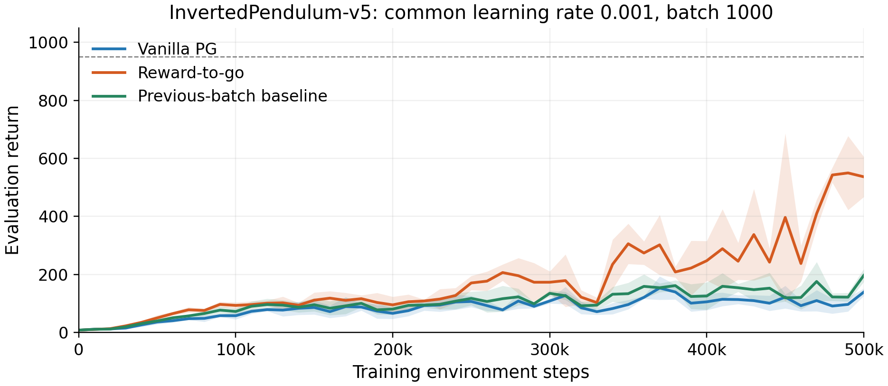
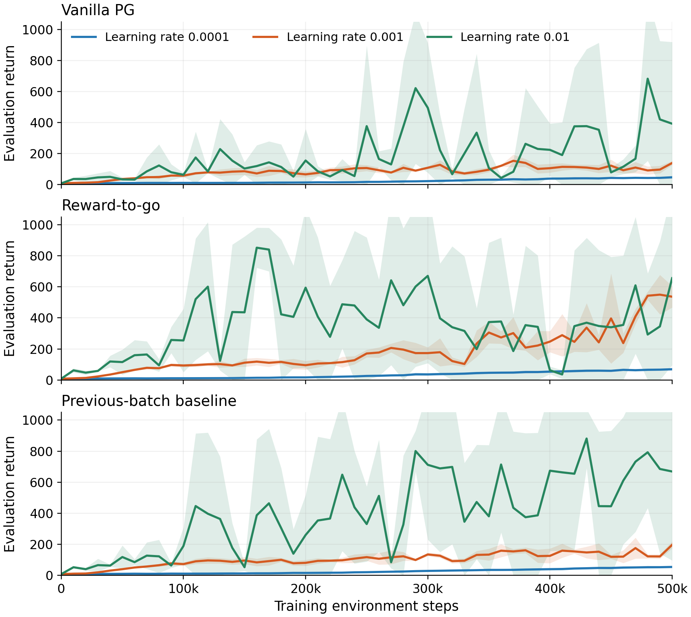
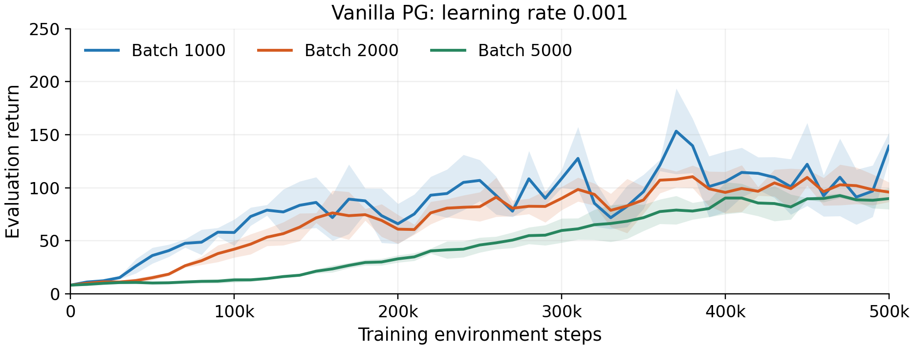
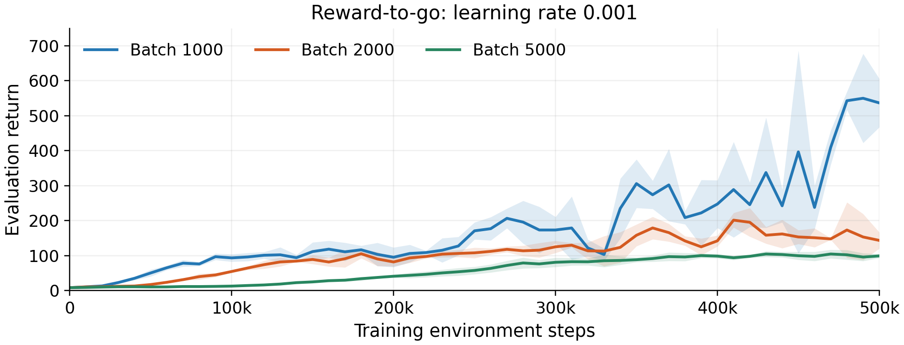
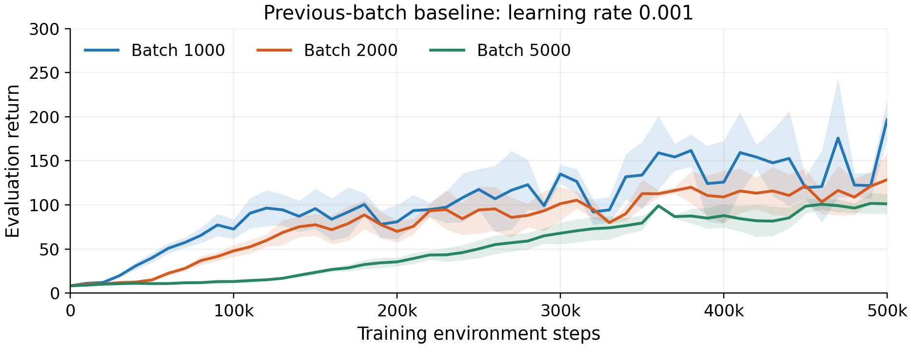
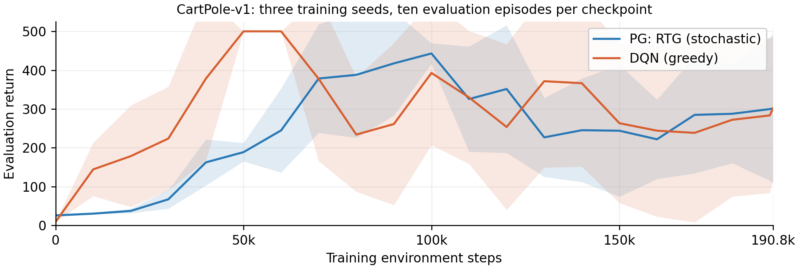
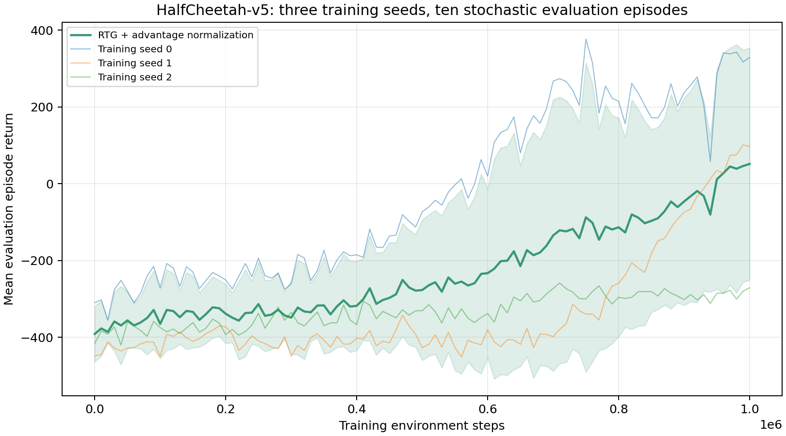
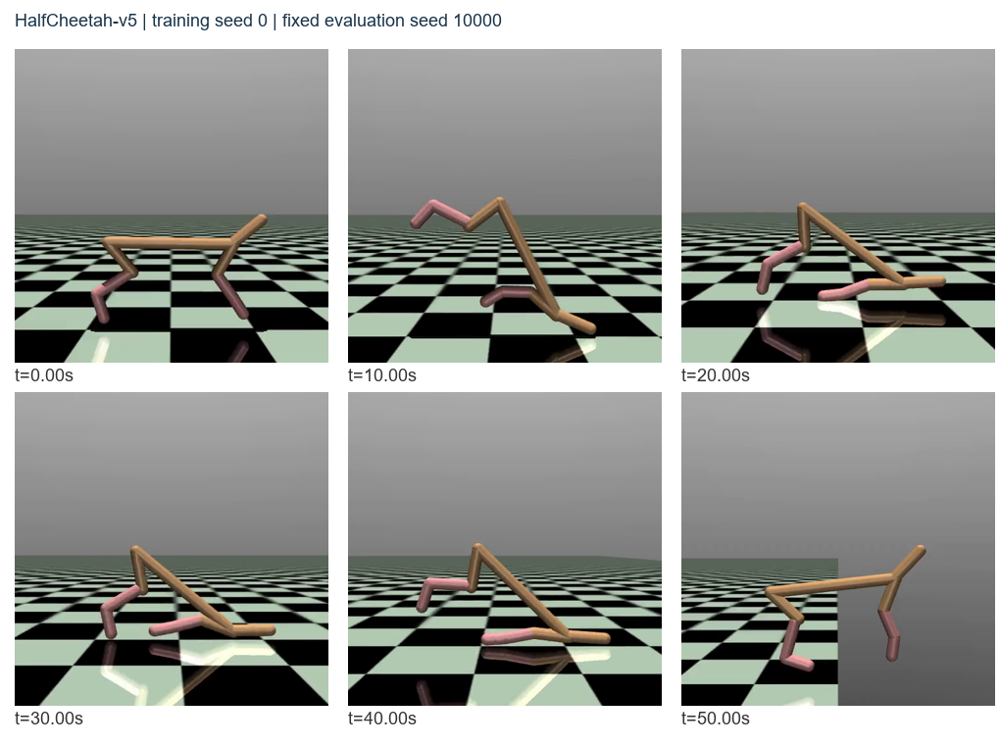

# Workshop 4: Policy Gradient - Final Report

Authors: Zhengnan Cao, Yuchen Yang

This report combines Task 1 and Task 2 using the corrected PG experiments. Unless stated otherwise, results use training seeds 0, 1 and 2; each checkpoint averages ten stochastic evaluation episodes with fixed seeds 10000-10009, isolated from training. Curves show the training-seed mean and one sample standard deviation, not a confidence interval. Evaluation steps are excluded from training budgets.

## Task 1 - Question 1: InvertedPendulum environment

### Question

What are the state space, action space and rewards? Are they finite or infinite, discrete or continuous? Is the environment deterministic or stochastic?

### Answer

| Component | Description and classification |
|---|---|
| State / observation | Cart position, pole angle, cart velocity and pole angular velocity; four continuous coordinates, with an unbounded observation Box and infinitely many possible values. |
| Action | One continuous cart-force command in [-3, 3]; bounded but with infinitely many possible values. |
| Reward | A finite, discrete reward: 1 after a healthy transition, 0 on a terminating transition. The 1000-step time limit bounds episode return by 1000. |

In the installed Gymnasium 1.3.0 implementation, an observation containing non-finite values or a pole angle with absolute value greater than 0.2 radians terminates the episode; the TimeLimit wrapper truncates at 1000 steps. Given the full simulator state and action, physics transitions are deterministic. Resets add uniform random noise, so episodes have stochastic initial states; sampling a stochastic policy introduces additional action randomness.

## Task 1 - Question 2: Vanilla PG, reward-to-go and baseline

### Question

Run the three PG methods on InvertedPendulum, visualize progress with TensorBoard, and assess training success and policy randomness.

### Submit

The required evaluation-return versus environment-step plot compares all three methods at learning rate 0.001, minimum batch 1000, gamma 0.99 and a 64 x 2 ReLU network. It reuses the nine corresponding corrected runs from Task 2, rather than treating them as additional experiments. Each run requests 500,000 training steps; final saved evaluations may slightly exceed this after a complete batch, while the plot ends at 500,000.

TensorBoard logging was enabled for these runs; the figure reconstructs the evaluation scalars from their CSV records. Event-file verification does not constitute a browser inspection.

### Discussion

**Does the learning curve indicate successful training?**

All methods improve, with final evaluation returns of 141.5 ± 13.6 for Vanilla, 536.3 ± 69.3 for RTG and 201.8 ± 20.9 for baseline. None achieves three consecutive evaluation means of at least 950, so these settings show learning but do not establish that the task is solved.

**Is the policy deterministic or stochastic?**

It is stochastic: a Gaussian actor samples actions during both training and evaluation; only the environment-executed action is clipped to its bounds. Fixing evaluation seeds makes those sampled episodes reproducible without making the policy deterministic.

## Task 2 - Question 1: Learning rate

### Question

Investigate at least three learning rates α in [0.00001, 0.01], including their interaction with reward-to-go and baseline.

### Submit

The three panels plot evaluation return against environment steps for learning rates 0.0001, 0.001 and 0.01. Minimum batch is 1000; the other Task 1 settings remain fixed.

Each cell is the across-seed mean ± SD of the average return over the final five evaluation checkpoints.

| Method / LR | 0.0001 | 0.001 | 0.01 |
|---|---:|---:|---:|
| Vanilla | 43.9 ± 5.9 | 106.1 ± 19.9 | 351.7 ± 305.2 |
| RTG | 66.2 ± 7.6 | 457.7 ± 45.8 | 452.6 ± 438.1 |
| Baseline | 52.4 ± 7.1 | 149.1 ± 24.0 | 700.7 ± 465.2 |

RTG includes the outer gamma-to-the-time-step factor, keeping discount powers relative to episode origin. Baseline is the mean discounted trajectory return from previous batches only, initially zero; it is not a same-batch mean or a learned value function. Core runs use Adam, with no advantage normalization, GAE or gradient clipping.

### Discussion

**Which learning rate achieves the fastest convergence?**

Using three consecutive evaluation means of at least 950, learning rate 0.01 is the fastest successful setting: RTG reaches this criterion in 2/3 seeds, with a success-conditioned median of 225,451 steps; baseline reaches it in 2/3 at 320,296.5 steps. Vanilla reaches it in only 1/3 at 500,249 steps, beyond the nominal 500,000-step budget; lower rates never reach it, and confirmation does not guarantee later stability.

**How does learning rate interact with RTG and baseline: does a higher rate amplify or mitigate their effect?**

Increasing the rate from 0.001 to 0.01 reduces RTG's last-five return advantage over Vanilla from 351.6 to 100.8, while increasing baseline's advantage from 43.0 to 349.0. Thus the observed interaction depends on the method: a higher rate does not uniformly strengthen variance-reduction benefits, and its large seed variation prevents a reliable universal ranking.

**Is this related to gradient-estimate variance: can a large rate amplify noisy updates or speed learning when variance is reduced?**

A larger rate can magnify noisy parameter changes, consistent with the irregular 0.01 curves and large across-seed spread, while also producing earlier threshold crossings. The fixed-policy diagnostic in Question 2 supports lower local gradient variance for RTG and baseline, but does not measure variance along the changing training policies or prove that noise alone caused these learning differences; Adam also rescales updates.

## Task 2 - Question 2: Steps per batch

### Question

Compare at least three batch-step settings for Vanilla PG, reward-to-go and baseline, and assess return, sample efficiency and gradient variance.

### Submit

The required three figures each compare minimum batch sizes 1000, 2000 and 5000 at learning rate 0.001. Each run has the same 500,000-step requested budget and finishes complete episodes; actual totals may slightly exceed that budget. Tables use final saved evaluations, while curve integration ends at the requested budget.

### Discussion

**For fixed environment steps, does increasing batch steps consistently improve final evaluation return?**

No: mean final returns decrease as batch grows from 1000 to 2000 to 5000: Vanilla 141.5 → 95.9 → 90.2, RTG 536.3 → 141.9 → 101.4, and baseline 201.8 → 130.1 → 100.8. More samples per update therefore do not improve final return in these tested settings.

**How does the trade-off between lower gradient variance and more computation per update appear in sample efficiency?**

From batch 1000 to 5000, mean update counts fall from 474.7, 450.3 and 469.0 to 100 for Vanilla, RTG and baseline. Their budget-normalized AUC returns also fall, respectively, from 84.1 to 47.8, 177.6 to 57.2 and 102.2 to 51.8. Larger batches show lower local diagnostic variance but lower AUC; fewer updates may contribute, although these measurements do not isolate the cause. Concurrent wall times do not establish computational-speed rankings.

**Does a larger batch reduce variance as strongly as in Vanilla, and which variance-reduction technique benefits least?**

Define benefit as the proportional reduction in gradient-covariance trace from batch 1000 to 5000. Both techniques show a stronger reduction than Vanilla at the tested frozen policy, but **baseline has the smaller benefit of the two techniques**: 74.0%, versus RTG's 76.2%.

| Estimator | Trace at batch 1000 | Trace at batch 5000 | Reduction |
|---|---:|---:|---:|
| Vanilla | 0.4381 | 0.1286 | 70.7% |
| RTG | 0.0840 | 0.0200 | 76.2% |
| Baseline | 0.1162 | 0.0302 | 74.0% |

This separate diagnostic uses 20 independent paired collections at one frozen initial policy; batch sizes are nested complete-episode prefixes. Baseline is fixed from an independent 5003-step calibration batch, outside formal training budgets. Results are conditional on that policy and calibration value; finite replicates, random batch lengths and step averaging limit a general or strictly unbiased interpretation, and do not prove the same ranking throughout learning.

## Task 2 - Question 3: CartPole PG versus DQN

### Question

Run PG on CartPole, tune its training budget, batch steps, learning rate, gamma and network size, and compare its learning speed with DQN.

### Submit

Both methods use three seeds, a 200,000-step requested budget, 64 x 3 ReLU networks and gamma 0.99. PG is newly trained; DQN reuses the WS3 baseline. Seed-0 pilots selected PG's method, learning rate and batch; reusing that seed may favor the selection.

| Setting | PG | DQN |
|---|---|---|
| Method; evaluation | RTG; stochastic | DQN; greedy |
| Learning rate; batch | 0.003; 2000 fresh steps | 0.001; batch 64 |
| Replay / update settings | Fresh on-policy batches | Capacity 100,000; warm-up 1000; target sync every 500 updates |

Observations after 200,000 steps are excluded. Linear interpolation uses the shared supported endpoint of **190,831 steps**, without extrapolation; AUC uses a common 10,000-step grid including that endpoint.

### Discussion

**Which algorithm converges faster, and what might explain the difference?**

DQN confirms three consecutive evaluation means of at least 475 in 3/3 seeds, with median 60,000 steps, versus 0/3 for PG; its AUC is also higher (298.8 ± 36.5 versus 248.1 ± 27.5). Replay reuse and frequent updates may improve sample efficiency compared with fresh on-policy batches. Different selected parameters and greedy versus stochastic evaluation prevent isolating the update rule, and threshold confirmation does not guarantee later stability.

## Task 2 - Question 4: HalfCheetah controller

### Question

Train and tune a PG controller for HalfCheetah, visualize progress with TensorBoard, submit its learning curve and inspect the trained agent in the video view.

### Submit

The required plot shows evaluation return versus environment steps. The selected controller uses RTG with advantage normalization, learning rate 0.001, batch 5000, gamma 0.99 and a 64 x 2 ReLU Gaussian actor. There is no critic or gradient clipping; each seed completes 1,000,000 steps. Normalization changes the finite-batch estimator and is an extension beyond the core Q1/Q2 comparison; exploratory seed-0 pilot selection can favor that seed.

| Training seed | Initial return | Final return | Last-five mean |
|---|---:|---:|---:|
| 0 | -309.9 | 328.7 | 333.5 |
| 1 | -448.3 | 97.0 | 74.8 |
| 2 | -416.3 | -271.1 | -282.9 |

### Observations

Mean final return is 51.5 ± 302.5, improved from -391.5 ± 72.4 initially, but seed 2 remains negative; this does not establish reliable control. TensorBoard scalars and a video preview were exported after training and checked at event-file level; no browser or Video-tab inspection is claimed.

The decoded, sampled frames show substantial posture changes. The independently reproduced seed-0 episode returns 364.09, travels 39.96 m in 50 seconds, and has absolute torso pitch above 45 degrees in 34.1% of recorded states; this is a descriptive threshold, not a solved rule. Its checkpoint still has one negative episode among ten evaluations, with worst return -441.05; decoding and sampled frames do not establish full-playback quality or uniformly reliable behavior.
